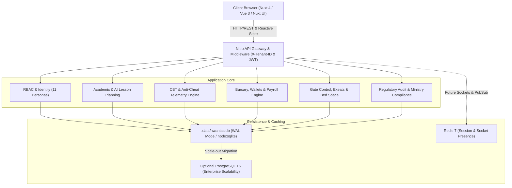
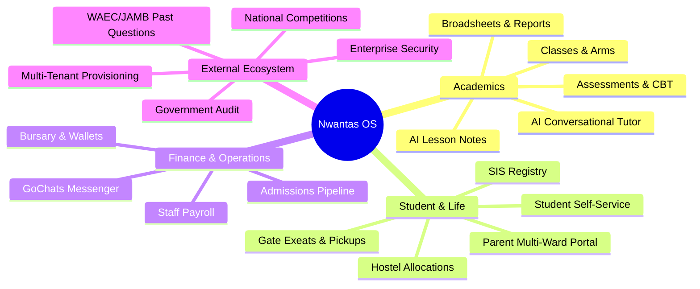
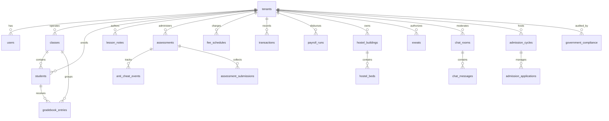

# Nwantas Platform: Master Source of Truth Specification & Engineering Blueprint

> **Document Version**: 2.0.0 Enterprise  
> **Status**: Active Living Source of Truth  
> **Platform**: Nwantas School Operating System Replica  
> **Architecture**: Multi-Tenant SSR Web Application, BFF REST API, Relational SQLite/PostgreSQL Engine  
> **Author**: Senior Systems Architect & DevOps Lead  

---

## 1. Executive Summary & Architectural Overview

Nwantas is an enterprise-grade School Management Operating System designed specifically for modern African and international educational institutions. The platform consolidates 20 mission-critical school functions into a unified, multi-tenant digital hub covering academic administration, continuous assessment, proctored examinations, student safeguarding, bursary operations, and regulatory reporting.



### 1.1 Technology Stack
- **Web Frontend**: Nuxt 4 (Vue 3, Composition API, Script Setup), Pinia state management.
- **UI & Design System**: Nuxt UI (`@nuxt/ui`), Tailwind CSS v4, Iconify (`heroicons`, `lucide`, `simple-icons`).
- **Server / BFF**: Nitro Server Engine (Node.js 24 runtime).
- **Local & Production Embedded Database**: Node 24 native `node:sqlite` (`DatabaseSync`) located at `.data/nwantas.db` with Write-Ahead Logging (`PRAGMA journal_mode = WAL;`) and enforced Foreign Key constraints (`PRAGMA foreign_keys = ON;`).
- **Enterprise Containerization**: Multi-stage `Dockerfile`, `docker-compose.yml` orchestrating Nuxt Web, Redis 7, and PostgreSQL 16.

### 1.2 Multi-Tenancy Isolation
Every request to the backend passes the institution context via the `X-Tenant-ID` header (e.g., `apex-academy` or `kingsway`). In database queries, tenant-specific records are partitioned by `tenant_id`.

---

## 2. Master RBAC Matrix (11 Personas)

| Persona Key | Display Title | Typical User | Primary Permissions |
| :--- | :--- | :--- | :--- |
| `master` | Platform Superadmin | System Operations | Manage all tenants, global platform telemetry, licensing |
| `federal_staff` | Federal Inspector | Federal Ministry of Education | View national compliance scores, audit certifications |
| `state_staff` | State QA Officer | State Ministry of Education | Conduct localized campus inspections, sign off audits |
| `school_owner` | Proprietor / Chairman | School Founder | Financial summaries, payroll approvals, institutional KPIs |
| `admin` | School Administrator | Head of Administration | Admissions pipeline, student profiles, classes, fee policies |
| `Principal` | Principal / Academic Director | School Principal | Approve AI lesson notes, publish CBT exams, sign report cards |
| `Registrar` | Academic Registrar | Admissions / Records | Enrollments, transcripts, transfer certificates, student IDs |
| `Bursar` | Chief Financial Officer | Bursary Department | Collect fees, disburse payroll, reconcile wallets, invoices |
| `Teacher` | Form / Subject Teacher | Classroom Faculty | AI lesson plan authoring, continuous assessments, CBT proctoring |
| `HostelWarden` | Head Hostel Warden | Boarding Department | Hostel room allocations, bed space vacancies, roll calls |
| `SecurityOfficer`| Chief Security Officer | Campus Main Gate | Guardian biometric photo matching, exeat timestamping |
| `Student` | Enrolled Scholar | Senior / Junior Secondary | Take CBT tests, review grades, AI tutor chat, past questions |
| `Parent` | Guardian / Sponsor | Ward Sponsor | Multi-ward switcher, fee checkout, live attendance, report cards |

---

## 3. The 20 Core Domains: Breakdown & Specification



---

### Domain 1: Multi-Tenant School Administration & Provisioning
- **Purpose**: Facilitate self-service school onboarding, institutional metadata management, and currency configuration.
- **Routes**: `/`, `/register-school`, `/dashboard`
- **Database Tables**: `tenants`
- **Key API Endpoints**:
  - `GET /api/v1/schools/:slug/info`: Fetch public institutional details and configuration.
  - `POST /api/v1/schools/register`: Onboard new academic institution with default term structures.

---

### Domain 2: Enterprise RBAC & Identity Management
- **Purpose**: Authenticate users, manage sessions, and enforce role-based access control across all 11 personas.
- **Routes**: `/auth/login`, Topbar Persona Switcher
- **Database Tables**: `users`, `tenants`
- **Key API Endpoints**:
  - `POST /api/v1/users/login`: Authenticate credentials, issue JWT with tenant and permission scope.
  - `GET /api/v1/users/profile`: Return authenticated user context.

---

### Domain 3: Student Information System (SIS) & Profiles
- **Purpose**: Centralized student lifecycle records, emergency contacts, medical flags, and hostel assignments.
- **Routes**: `/dashboard/students`
- **Database Tables**: `students`, `classes`
- **Key API Endpoints**:
  - `GET /api/v1/students?classArmId=...`: List students filtered by class arm.
  - `POST /api/v1/students`: Enroll new student.
  - `GET /api/v1/students/:id`: Fetch student dossier.

---

### Domain 4: Classroom Arm & Academic Structure Management
- **Purpose**: Define academic levels (JSS 1 through SS 3), class arms (Gold, Diamond, Science), capacities, and form tutors.
- **Routes**: `/dashboard/academics/classes`
- **Database Tables**: `classes`
- **Key API Endpoints**:
  - `GET /api/v1/classes`: Return all class arms with enrollment counts.
  - `POST /api/v1/classes`: Create new class arm.

---

### Domain 5: AI-Powered Lesson Planning & Multi-Stage Approval Workflow
- **Purpose**: Generate curriculum-compliant 4-phase pedagogical lesson notes aligned with NERDC and Cambridge standards, with formal HOD and Principal review.
- **Routes**: `/dashboard/academics/lesson-notes`
- **Database Tables**: `lesson_notes`
- **Key API Endpoints**:
  - `GET /api/v1/lesson-notes`: List notes with status (`Draft`, `HOD Approved`, `Principal Approved`).
  - `POST /api/v1/lesson-notes/generate`: Generate note using pedagogical AI engine.
  - `POST /api/v1/lesson-notes/:id/approve`: Endorse note with digital signature.

---

### Domain 6: Computer-Based Testing (CBT) & Assessment Engine
- **Purpose**: Conduct timed, proctored examinations with dynamic question delivery, instant grading, and automated feedback.
- **Routes**: `/dashboard/academics/assessments`, `/dashboard/cbt/take/:id`
- **Database Tables**: `assessments`, `assessment_submissions`
- **Key API Endpoints**:
  - `GET /api/v1/assessments`: Fetch scheduled and active assessments.
  - `GET /api/v1/assessments/:id`: Fetch assessment question bank.
  - `POST /api/v1/assessments/:id/submit`: Evaluate candidate submission and calculate score.

---

### Domain 7: Real-Time Proctored Anti-Cheat Telemetry Engine
- **Purpose**: Monitor test-taker environment for window blur, tab switching, copy-pasting, and fullscreen exit violations.
- **Routes**: Embedded in `/dashboard/cbt/take/:id`
- **Database Tables**: `anti_cheat_events`
- **Key API Endpoints**:
  - `POST /api/v1/assessments/:id/monitoring-events`: Stream client integrity events to proctor console.

---

### Domain 8: Automated Grading, Broadsheet Collation & Report Cards
- **Purpose**: Calculate weighted continuous assessments (CA 20% + Midterm 20% + Exam 60%), compute GPA, class rank, and generate printable PDF report cards.
- **Routes**: `/dashboard/academics/gradebook`
- **Database Tables**: `gradebook_entries`, `students`
- **Key API Endpoints**:
  - `POST /api/v1/gradebooks/collate`: Recalculate scores and rankings for class arm.
  - `GET /api/v1/term-reports/:studentId`: Retrieve student term report card.

---

### Domain 9: Bursary, Tuition Billing & Multi-Currency Wallets
- **Purpose**: Manage school fee schedules, installment tracking, payment gateway collection (Paystack/Flutterwave), and bursary balance reconciliation.
- **Routes**: `/dashboard/finances`
- **Database Tables**: `fee_schedules`, `transactions`, `tenants`
- **Key API Endpoints**:
  - `GET /api/v1/wallet`: Retrieve balance, bank settlement account, and recent payments.
  - `POST /api/v1/wallet/charges/create`: Initiate payment intent.

---

### Domain 10: Institutional Payroll Engine & Staff Remuneration
- **Purpose**: Calculate monthly staff salaries, statutory pension and PAYE deductions, and manage proprietor disbursement authorization.
- **Routes**: Integrated in `/dashboard/finances`
- **Database Tables**: `payroll_runs`
- **Key API Endpoints**:
  - `GET /api/v1/payroll/runs`: Retrieve monthly payroll records and disbursement status.
  - `POST /api/v1/payroll/:id/disburse`: Authorize salary disbursement.

---

### Domain 11: Boarding House & Bed Space Allocation Management
- **Purpose**: Track hostel buildings, room capacities, occupied vs. vacant bed codes, and boarding student assignments.
- **Routes**: `/dashboard/accommodations`
- **Database Tables**: `hostel_buildings`, `hostel_beds`
- **Key API Endpoints**:
  - `GET /api/v1/accommodations/buildings`: Retrieve hostel inventory and bed occupancy status.
  - `POST /api/v1/accommodations/beds/:id/allocate`: Assign student to bed.

---

### Domain 12: Campus Gate Security, Biometric Pickups & Exeat Management
- **Purpose**: Verify authorized guardians via photo matching at campus gate, issue medical/weekend exeat passes, and record arrival/departure timestamps.
- **Routes**: `/dashboard/security`
- **Database Tables**: `exeats`, `guardian_pickups`
- **Key API Endpoints**:
  - `GET /api/v1/security/exeats`: Retrieve active and past exeat passes.
  - `POST /api/v1/security/exeats`: Request/approve new exeat pass.
  - `POST /api/v1/security/pickups/verify`: Match guardian photo and clear student departure.

---

### Domain 13: GoChats Real-Time Collaborative Messenger
- **Purpose**: Structured school communication channels (Staff General, Departmental, Class PTA) with emoji reactions and file sharing.
- **Routes**: `/dashboard/chat`
- **Database Tables**: `chat_rooms`, `chat_messages`
- **Key API Endpoints**:
  - `GET /api/v1/chat/rooms`: List user-accessible chat channels.
  - `GET /api/v1/chat/rooms/:id/messages`: Retrieve chat message history.
  - `POST /api/v1/chat/rooms/:id/messages`: Send message with reactions.

---

### Domain 14: Conversational 24/7 AI Tutor & Contextual Homework Assistant
- **Purpose**: Context-aware student learning companion providing step-by-step problem walkthroughs, Socratic questioning, and curriculum concept explanations.
- **Routes**: `/dashboard/ai-tutor`
- **Key API Endpoints**:
  - `POST /api/v1/ai-tutor/chat`: Conversational AI tutor session endpoint.

---

### Domain 15: Parent Portal & Multi-Ward Lifecycle Monitoring
- **Purpose**: Dedicated parent experience allowing seamless switching between multiple enrolled children, reviewing live attendance rates, viewing report cards, and paying tuition.
- **Routes**: `/parents/dashboard`
- **Key API Endpoints**:
  - Integrates `GET /api/v1/students`, `GET /api/v1/term-reports/:id`, and `POST /api/v1/wallet/charges/create`.

---

### Domain 16: Student Academic Portal & Self-Service Learning
- **Purpose**: Student dashboard for checking exam timetables, taking CBT quizzes, downloading lesson summaries, and reviewing past term cards.
- **Routes**: `/dashboard`, `/dashboard/cbt/take/:id`

---

### Domain 17: Admissions Pipeline, Application Tracking & Entrance Testing
- **Purpose**: Public admissions portal, applicant form submission, document attachment, entrance CBT exam score tracking, and acceptance workflow.
- **Routes**: `/admissions`, `/dashboard/admissions`
- **Database Tables**: `admission_cycles`, `admission_applications`
- **Key API Endpoints**:
  - `GET /api/v1/admissions/cycles`: Fetch open application cycles.
  - `POST /api/v1/admissions/apply`: Submit student admission application.

---

### Domain 18: Past Question Archive & Standardized Exam Preparation
- **Purpose**: Searchable repository of WAEC, JAMB UTME, NECO, and Cambridge IGCSE examination questions with timed speed drills.
- **Routes**: `/past-questions`
- **Database Tables**: `past_questions`
- **Key API Endpoints**:
  - `GET /api/v1/past-questions`: Filter past papers by examination body, year, and subject.

---

### Domain 19: Inter-School National Competitions & STEM Olympiads
- **Purpose**: Showcase national inter-school mathematics olympiads, debate championships, live leaderboards, and registered school representatives.
- **Routes**: `/competitions`
- **Database Tables**: `competitions`
- **Key API Endpoints**:
  - `GET /api/v1/competitions`: Fetch active competitions and leaderboard standings.

---

### Domain 20: Ministry of Education & Regulatory Compliance Audit
- **Purpose**: Quality assurance portal for federal and state ministry inspectors to audit teacher TRCN certifications, lab equipment standards, and safety compliance.
- **Routes**: `/dashboard/government`
- **Database Tables**: `government_compliance`
- **Key API Endpoints**:
  - `GET /api/v1/government/compliance`: Retrieve accreditation rating, category compliance scores, and inspection citations.

---

## 4. Complete Relational Database Schema (DDL)



### Table Definitions & Specifications

| # | Table Name | Primary Key | Key Columns & Types | Description |
| :--- | :--- | :--- | :--- | :--- |
| 1 | `tenants` | `id` (TEXT) | `name`, `slug`, `currency`, `wallet_balance` | Educational institutions |
| 2 | `users` | `id` (TEXT) | `tenant_id`, `name`, `email`, `role`, `permissions_json` | RBAC user accounts |
| 3 | `classes` | `id` (TEXT) | `tenant_id`, `level`, `arm`, `student_count`, `capacity` | Academic class arms |
| 4 | `students` | `id` (TEXT) | `tenant_id`, `admission_no`, `name`, `class_arm_id`, `fee_status` | Enrolled student registry |
| 5 | `lesson_notes` | `id` (TEXT) | `tenant_id`, `subject`, `topic`, `status`, `sections_json` | AI lesson plans |
| 6 | `assessments` | `id` (TEXT) | `tenant_id`, `title`, `duration_minutes`, `questions_json` | CBT examinations |
| 7 | `anti_cheat_events` | `id` (TEXT) | `assessment_id`, `student_id`, `event_type`, `timestamp` | Proctoring violation logs |
| 8 | `assessment_submissions` | `id` (TEXT) | `assessment_id`, `student_id`, `score`, `percentage` | Candidate exam answers |
| 9 | `gradebook_entries` | `id` (TEXT) | `tenant_id`, `student_id`, `class_arm_id`, `total_score`, `letter_grade` | Broadsheet CA & exam scores |
| 10 | `fee_schedules` | `id` (TEXT) | `tenant_id`, `title`, `amount`, `category` | Tuition & levies schedule |
| 11 | `transactions` | `id` (TEXT) | `tenant_id`, `student_name`, `amount`, `channel`, `status` | Bursary payment receipts |
| 12 | `payroll_runs` | `id` (TEXT) | `tenant_id`, `month`, `gross_salary`, `net_disbursement`, `status` | Monthly salary runs |
| 13 | `hostel_buildings` | `id` (TEXT) | `tenant_id`, `name`, `warden`, `total_beds`, `occupied_beds` | Boarding dormitories |
| 14 | `hostel_beds` | `id` (TEXT) | `building_id`, `room_number`, `bed_code`, `status`, `student_id` | Bed space inventory |
| 15 | `exeats` | `id` (TEXT) | `tenant_id`, `student_id`, `type`, `departure_time`, `status` | Campus gate departure passes |
| 16 | `guardian_pickups` | `id` (TEXT) | `tenant_id`, `student_id`, `guardian_name`, `status`, `pickup_date` | Gate biometric verification logs |
| 17 | `chat_rooms` | `id` (TEXT) | `tenant_id`, `name`, `type`, `unread_count` | GoChats communication channels |
| 18 | `chat_messages` | `id` (TEXT) | `room_id`, `sender_name`, `sender_role`, `text`, `timestamp` | GoChats chat messages |
| 19 | `admission_cycles` | `id` (TEXT) | `tenant_id`, `title`, `application_fee`, `status` | Open admissions campaigns |
| 20 | `admission_applications` | `id` (TEXT) | `cycle_id`, `applicant_name`, `applying_for_class`, `status` | Incoming admission dossiers |
| 21 | `past_questions` | `id` (TEXT) | `exam_body`, `year`, `subject`, `total_questions` | Standardized exam archives |
| 22 | `competitions` | `id` (TEXT) | `title`, `category`, `current_round`, `leaderboard_json` | Inter-school Olympiads |
| 23 | `government_compliance`| `id` (TEXT) | `tenant_id`, `accreditation_rating`, `categories_json` | Regulatory inspection scorecard |

---

## 5. DevOps, Deployment & Operational Runbook

### 5.1 Local Development Commands
```bash
# 1. Install dependencies
npm install

# 2. Seed / verify local SQLite database
npm run db:seed

# 3. Reset database to clean initial state (schema + realistic seed data)
npm run db:reset

# 4. Start local development server (Nuxt 4 / Nitro)
npm run dev

# 5. Typecheck codebase (Vue 3 / TypeScript)
npm run typecheck
```

### 5.2 Containerized Production Deployment
```bash
# 1. Build and boot services in background (Web, Redis, Postgres)
npm run docker:up
# Or directly via docker compose:
docker compose up -d --build

# 2. Check health status of all containers
docker compose ps

# 3. Inspect application container logs
docker compose logs -f web

# 4. Tear down containers cleanly
npm run docker:down
```

### 5.3 Database Backup & Durability Procedure
- **SQLite Database Path**: `.data/nwantas.db`
- **WAL Files**: `.data/nwantas.db-wal`, `.data/nwantas.db-shm`
- **Backup Command**:
  ```bash
  # Execute safe backup while WAL mode is active
  sqlite3 .data/nwantas.db ".backup .data/backup_$(date +%Y%m%d_%H%M%S).db"
  ```

---

## 6. Phased Implementation Roadmap & Progress Tracker

- [x] **Phase 1: Multi-Tenant Architecture & Core Layouts**
  - [x] App shell with dynamic theme & persona switcher (`app/app.vue`, `app/layouts/dashboard.vue`, `app/layouts/default.vue`, `app/layouts/parent.vue`, `app/layouts/cbt.vue`).
  - [x] RBAC store with all 11 persona tokens (`app/stores/auth.ts`).
  - [x] Multi-tenant switcher supporting NGN (₦) and GBP (£) (`app/stores/tenant.ts`).
  - [x] Public marketing, admissions, past questions, and competitions pages.

- [x] **Phase 2: Academic Domain, AI Lesson Planning & CBT Engine**
  - [x] Classroom management (`/dashboard/academics/classes`).
  - [x] AI Lesson note generation and principal approval workflow (`/dashboard/academics/lesson-notes`).
  - [x] Continuous assessment dashboard (`/dashboard/academics/assessments`).
  - [x] Fullscreen CBT exam experience with live anti-cheat proctoring (`/dashboard/cbt/take/:id`).

- [x] **Phase 3: Broadsheets, Bursary Finances & Campus Security**
  - [x] Class broadsheet collation and student report card generator (`/dashboard/academics/gradebook`).
  - [x] Multi-currency bursary wallet, fee schedules, and staff payroll (`/dashboard/finances`).
  - [x] Boarding house dormitory and bed vacancy management (`/dashboard/accommodations`).
  - [x] Gate security, guardian biometric photo verification, and exeat passes (`/dashboard/security`).

- [x] **Phase 4: Collaboration, AI Pedagogy & Specialized Portals**
  - [x] GoChats real-time messenger (`/dashboard/chat`).
  - [x] 24/7 Conversational AI Tutor (`/dashboard/ai-tutor`).
  - [x] Dedicated Parent Portal with multi-ward switching (`/parents/dashboard`).
  - [x] Ministry of Education regulatory compliance audit (`/dashboard/government`).

- [x] **Phase 5: Seamless Relational Persistence & DevOps Infrastructure**
  - [x] Node 24 native `node:sqlite` engine at `.data/nwantas.db` with WAL mode.
  - [x] Relational schema (`server/database/schema.sql`) covering 23 tables.
  - [x] Automatic database lifecycle plugin (`server/plugins/database.ts`).
  - [x] Reactive SQLite query/mutation bridge (`server/database/index.ts`, `server/utils/db.ts`).
  - [x] CLI seed and reset utilities (`npm run db:seed`, `npm run db:reset`).
  - [x] Multi-stage production `Dockerfile` and `docker-compose.yml` with Redis and Postgres.
  - [x] Comprehensive `.env.example` configuration template.

- [ ] **Phase 6: Future Production Enhancements (Upcoming)**
  - [ ] Live WebSocket clustering for GoChats via Redis Pub/Sub.
  - [ ] Webhook receiver for Paystack & Flutterwave automatic fee reconciliation.
  - [ ] Automated PDF export for terminal report cards via Headless Chrome / Puppeteer.
