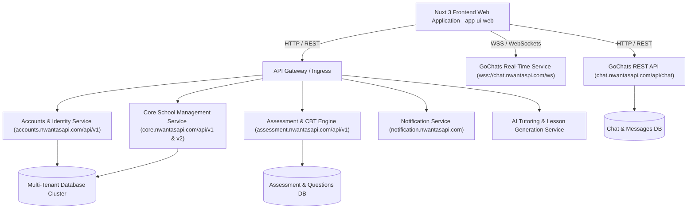
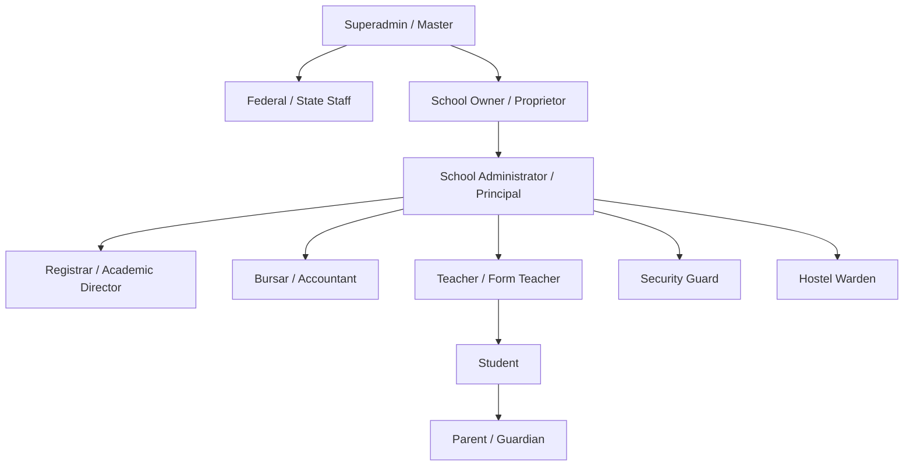

# NWANTAS COMPLETE SCHOOL MANAGEMENT PLATFORM
## SYSTEM ARCHITECTURE & EXHAUSTIVE SOURCE OF TRUTH SPECIFICATION

> **Target Source**: [Nwantas | Complete School Management](https://nwantas.com/)  
> **Extraction & Reverse Engineering Engine**: REA (Reverse Engineer Anything)  
> **Target Production Application**: Nuxt 3 (SSR + CSR), Vue 3 Composition API, Microservices Ecosystem  
> **Classification**: Enterprise Multi-Tenant Educational Management Information System (EMIS), Learning Management System (LMS), and Government Compliance Platform  
> **Date of Reverse Engineering**: October 2026

---

## 1. EXECUTIVE SUMMARY & PLATFORM IDENTITY

**Nwantas** is an enterprise-grade, all-in-one educational operating system catering to primary, secondary, all-through schools, and multi-campus educational conglomerates across Nigeria, the United Kingdom, and international jurisdictions.

The platform eliminates administrative fragmentation by unifying 20 distinct institutional domains into a single synchronized ecosystem:
1. **Multi-Tenant Institutional CMS & Portal Engine**
2. **Identity, Auth & Multi-Tier RBAC (11 Persona Dashboards)**
3. **Student Information System (SIS) & Lifecycle Progression**
4. **Digital Admissions Pipeline & Entrance Examination System**
5. **Curriculum, Class Arm & Subject Management**
6. **AI-Powered Lesson Planning & Collaborative Review Suite**
7. **Assessments, Computer-Based Testing (CBT) & Anti-Cheat Monitoring**
8. **Automated Gradebook, Weightages & Report Card Generation (PDF)**
9. **Conversational AI Tutor & Adaptive Study Planner**
10. **Finances, Multi-Wallet System & Automated Fee Billing**
11. **Institutional Payroll & Staff Salary Disbursements**
12. **Hostel & Bed-Space Accommodation Management**
13. **Campus Gate Security, Exeat Movements & Child Pickup Safety**
14. **Real-Time Communication "GoChats" (WebSocket & REST)**
15. **Priority Announcements, In-App Notifications & Calendar Integration**
16. **Dedicated Parent Portal with Multi-Child Switching**
17. **Government & Ministry of Education Oversight Engine**
18. **Inter-School Competitions & Tournament Leaderboards**
19. **Campus Democracy & Student Council Polling**
20. **Digital Library & Content Access-Control System**

---

## 2. SYSTEM TOPOLOGY & BACKEND MICROSERVICES

Reverse-engineering the compiled runtime configurations (`window.__NUXT__.config`) and network dispatchers reveals a distributed microservices topology connected via REST and WebSockets:



### Microservice Endpoints & Hostnames
| Service Name | Production Endpoint | Protocol | Responsibilities |
|---|---|---|---|
| **Accounts API v1** | `https://accounts.nwantasapi.com/api/v1` | HTTPS / REST | User authentication, session management, school registration, tenant verification, RBAC permissions check, profile updates. |
| **Accounts API Base** | `https://accounts.nwantasapi.com/api` | HTTPS / REST | Auth tokens, refresh tokens, Google OAuth, OTP verification. |
| **Core API v1** | `https://core.nwantasapi.com/api/v1` | HTTPS / REST | Classes, subjects, teachers, students, attendance, fees, payroll, accommodations, security. |
| **Core API v2** | `https://core.nwantasapi.com/api/v2` | HTTPS / REST | Advanced workflows, government submissions, and bulk operations. |
| **GoChats REST** | `https://chat.nwantasapi.com/api/chat` | HTTPS / REST | Chat rooms, direct messages, message reactions, file attachments (up to 10MB). |
| **GoChats Realtime** | `wss://chat.nwantaspi.com/ws?user_id={id}` | WSS (WebSocket) | Instant messaging, typing indicators, read receipts, room join/leave, presence. |
| **Assessments API** | `https://assessment.nwantasapi.com/api/v1` | HTTPS / REST | CBT exam creation, test sessions, anti-cheat monitoring events, student answers, grading. |
| **Notifications API** | `https://notification.nwantasapi.com` | HTTPS / REST | Multi-channel notifications (in-app alerts, email dispatches, SMS priority alerts). |
| **AI Service Base** | Configurable (`aiServiceBaseUrl`) | HTTPS / REST | AI Tutor study planning, conversational guidance, concept explanation, lesson note generation. |

### Telemetry, Logging & Observability
* **Sentry Ingestion**: `https://a624c7458dbfa59c8d6fc7e8e19ef359@o4510057000927232.ingest.de.sentry.io/4510077915758672`
* **OpenTelemetry (OTEL)**: Enabled (`serviceName: "app-ui-web"`, `deploymentEnvironment: "production"`).
* **Robots / Indexing Policy**: Hardened private tenant policy: `noindex, nofollow, noarchive, nosnippet`.

---

## 3. MULTI-TENANCY ARCHITECTURE & ROUTING ALGORITHM

Nwantas utilizes a **Hybrid Subdomain + Header multi-tenancy model**.

### Subdomain Resolution Engine
The client and SSR server evaluate the HTTP Host header against reserved system subdomains:
```typescript
const RESERVED_SUBDOMAINS = new Set([
  "admin", "api", "app", "assets", "cdn", "dashboard", 
  "mail", "static", "staging", "status", "support", "www"
]);

function extractTenantSlug(host: string, appDomain: string): string | null {
  if (!host) return null;
  const normalizedHost = host.split(":")[0].trim().toLowerCase();
  
  // Local development support (*.localhost)
  if (normalizedHost.includes(".localhost")) {
    const parts = normalizedHost.split(".");
    if (parts.length >= 2 && parts[parts.length - 1] === "localhost") {
      return RESERVED_SUBDOMAINS.has(parts[0]) ? null : parts[0];
    }
  }
  
  // Production domain support (*.nwantas.com)
  if (appDomain) {
    if (normalizedHost === appDomain || normalizedHost === `www.${appDomain}`) return null;
    if (normalizedHost.endsWith(`.${appDomain}`)) {
      const slug = normalizedHost.slice(0, -(appDomain.length + 1));
      return RESERVED_SUBDOMAINS.has(slug) ? null : slug;
    }
  }
  
  const parts = normalizedHost.split(".");
  if (parts.length >= 3) {
    return RESERVED_SUBDOMAINS.has(parts[0]) ? null : parts[0];
  }
  return null;
}
```

### Tenant Identification & Context Binding
1. **Explicit Header**: Inspects incoming request headers for `X-Tenant-ID` or `x-tenant-id`.
2. **Subdomain Lookup**: If no header is present, the extracted `slug` triggers a tenant resolution query:
   ```http
   GET https://accounts.nwantasapi.com/api/v1/schools/{slug}/info
   Accept: application/json
   ```
   Returns: `{ "data": { "id": "uuid-v4", "name": "...", "slug": "..." } }`.
3. **Session Fallback**: Inspects user session `session.school.id`. If matches active slug, binds context.
4. **Header Injection**: All subsequent API queries from the client composable automatically inject:
   ```http
   X-Tenant-ID: {school_id}
   Authorization: Bearer {jwt_access_token}
   ```

---

## 4. ROLE-BASED ACCESS CONTROL (RBAC) & PERSONA TAXONOMY

The system enforces an SSR & Client-side Route Guard for 11 distinct user roles:



### Complete Persona Breakdown
1. **Superadmin / Master (`master`)**: Complete platform oversight, package configuration, global tenant provisioning.
2. **Government Inspector (`federal_staff`, `state_staff`)**: Ministry of Education oversight, school compliance auditing, national curriculum publishing, inspection citations.
3. **School Owner (`school_owner`)**: Legal owner, primary billing, institutional packages, banking setup, executive reports.
4. **School Administrator / Principal (`admin`, `Principal`)**: Full campus operations, staff management, admissions, approvals, scheduling.
5. **Registrar (`Registrar`)**: Academic records, grading systems, report card collation, graduation, certificates.
6. **Teacher (`Teacher`)**: Classroom attendance, lesson note drafting, CBT assessment creation, grading, student progress reporting.
7. **Bursar / Finance Officer**: Tuition fees structuring, school wallet reconciliation, payment links, payroll processing.
8. **Hostel Warden**: Hostel buildings, room allocation, bed vacancies, student sign-in/sign-out.
9. **Security Officer**: Campus gate control, student exeat movements, authorized guardian pickup verification.
10. **Student (`Student`)**: Learning dashboard, CBT exams, practice questions, AI tutor, assignments, student groups, hostel requests.
11. **Parent (`Parent`)**: Multi-child view, academic results, attendance tracking, fee payments, parent-teacher office hours, communication.

### SSR Route Permission Gate
Guarded paths (`/dashboard`, `/parents/dashboard`, `/past-questions`) evaluate:
* `route.meta.requiredPermissions: string[]`
* `route.meta.requireAllPermissions: boolean`
* Evaluated against:
  ```http
  GET https://accounts.nwantasapi.com/api/v1/users/{user_id}/permissions
  Headers:
    Authorization: Bearer {token}
    X-Tenant-ID: {tenant_id}
  ```

---

## 5. REVERSE-ENGINEERED FUNCTIONAL MODULES

### Module 1: Institutional Onboarding & Website CMS
* **URL Routes**: `/register-school`, `/onboarding`, `/dashboard/settings/school/website`
* **Features**:
  * Step 1: Personal profile creation (Name, email, password, phone, country).
  * Step 2: School profile setup (School name, real-time slug verification with `.nwantas.com`, founding year, address, LGA/City, State, Country).
  * Package selection dynamically localized by timezone (e.g., Africa/Lagos -> NGN, Europe/London -> GBP).
  * Automated slug generator with 500ms debounce.
  * Auto-login with 4-second database replication delay and redirect to `/dashboard`.
  * Public School Website builder: hero banners, programs, facilities, news, testimonials, admissions notices.

### Module 2: Digital Admissions Pipeline
* **URL Routes**: `/dashboard/students/admission`, `/admission/cycles`, `/admission/apply`, `/parents/dashboard/admissions`
* **Features**:
  * Admission Cycles: Academic year cycle definitions, opening/closing dates, application fee toggle.
  * Class Level Association: Specific class levels open for admissions per cycle.
  * Requirement Checklists: Mandatory document uploads (birth certificate, immunization, past records).
  * Entrance Exam Integration: Attaches CBT test papers directly to admission cycles.
  * Online & Paper-based processing (`/dashboard/students/admission/cycles/:id/paper`).
  * Status Flow: `Draft` -> `Submitted` -> `Entrance Exam Pending` -> `Under Review` -> `Accepted` / `Rejected` -> `Enrolled`.

### Module 3: Student Information System & Lifecycle Progression
* **URL Routes**: `/dashboard/students`, `/dashboard/students/progression/*`
* **Features**:
  * Comprehensive Student Profiles: Bio-data, emergency contacts, medical records, parent linkage.
  * Academic Progression:
    * **Promotion Engine**: Batch promotion of students meeting passing grade criteria to next class level.
    * **Demotion Engine**: Documented class retention workflows.
    * **Graduation Management**: Final term graduation clearance, graduand rosters (`/api/graduands`).
    * **Certificate Generation**: Automated issuance and verification of graduation certificates.

### Module 4: Academics, Curriculum & Syllabi
* **URL Routes**: `/dashboard/classes`, `/dashboard/classes/school-subjects`, `/dashboard/classes/syllabi`
* **Features**:
  * Academic Years & Terms: Support for 3-term, 2-semester, or custom term systems.
  * Class Levels & Class Arms: Managing classes (e.g., JSS1 Gold, Grade 10 A).
  * Subject Assignment: Multi-teacher assignment per subject, core vs elective designations.
  * Syllabi Library: Global standard syllabi vs school-customized syllabi.

### Module 5: AI-Assisted Lesson Planning & Review Workflow
* **URL Routes**: `/dashboard/classes/lesson-content`, `/dashboard/my-classes/my-notes`
* **Features**:
  * **AI Lesson Generation**: `POST /api/lesson-notes/generate` creates structured lesson plans from topic, syllabus, and objectives.
  * **Rich Text Review Editor**: `LessonNoteReviewEditor.CQNzke9l.css` with structured pedagogical sections.
  * **Collaborative Commenting**: Inline document annotations, threaded replies, comment resolution (`resolve`/`unresolve`), and orphan synchronization.
  * **Approval Hierarchy**: Teacher drafts -> Marks "Ready for Approval" -> HOD / Principal reviews and adds comments -> Approves -> Publishes to students and parents.

### Module 6: Assessments, CBT & Anti-Cheat Engine
* **URL Routes**: `/dashboard/my-classes/:id/assessments`, `/past-questions/:id/practice`
* **Features**:
  * Diverse Assessment Types: Homework, quizzes, continuous assessments (CA), midterm exams, final examinations.
  * **Anti-Cheat Monitoring Engine**:
    * Event Tracking: `POST /api/assessments/:id/monitoring-events`.
    * Client telemetry logs: Window blur, tab switching, copy-paste shortcuts, fullscreen termination.
  * **Server-Synchronized CBT Timer**:
    * Queries `GET /api/assessments/session/remaining?assessmentId=...` to prevent local device clock tampering.
  * **Past Questions Bank**: Exam mode vs Practice mode with instant AI answer explanations.

### Module 7: Gradebook, Weightages & Report Card Engine
* **URL Routes**: `/dashboard/settings/school/grading/*`, `/dashboard/my-classes/:id/gradebook`
* **Features**:
  * Grading Scales: Configurable grading schemes (letter grades, 4.0/5.0 GPA scales, percentage ranges).
  * Assessment Weightages: Weighting homework (10%), quizzes (10%), midterm (20%), exams (60%).
  * Exclude-from-grading toggle for formative exercises.
  * **Grade Collation Engine**: `POST /api/gradebooks/collate` automates term aggregate calculations.
  * **Term Report Cards**: Automated compilation of class position, subject scores, teacher remarks, principal signoff, and direct PDF generation (`GET /api/term-reports/:id/pdf`).

### Module 8: Conversational AI Tutor & Adaptive Learning
* **URL Routes**: `/dashboard/AI/tutor/:planId`, `/parents/dashboard/ai/*`
* **Features**:
  * Personalized Study Plans: Generated from student performance gaps or syllabus topics.
  * Module Kickoff & Outline: Dynamic chapter outlines with structured learning modules.
  * Interactive AI Chat: `POST /api/tutor/study-plans/:planId/modules/:moduleId/learning/messages`.
  * Contextual Explanation: `POST .../explain-selection` enables students to highlight difficult text and receive immediate step-by-step simplification.
  * Embedded practice quizzes and final module exams.

### Module 9: Financial Management, Billing & Multi-Wallets
* **URL Routes**: `/dashboard/finances/*`, `/parents/dashboard/finance/*`
* **Features**:
  * Wallet Architecture:
    * **School Wallet**: Central tuition collection, operational fund balances.
    * **My Wallet (Staff/Parent)**: Personal disbursement and reimbursement wallet.
    * **Government Wallet**: State commission allocations and statutory fees.
  * Fee Schedules: Mandatory vs optional items, class-level pricing, discount scholarships.
  * Payment Plans: Flexible instalment schedules (`POST /api/wallet/instalment-plan`).
  * Hosted Payment Links: Ad-hoc payment links with real-time verification (`/payments/link/:token`).
  * Integrated Gateways: Paystack, Flutterwave, Stripe.

### Module 10: Institutional Payroll Management
* **URL Routes**: `/dashboard/finances/payroll/*`
* **Features**:
  * Staff Payroll Profiles: Base salary, allowances, pension, tax deductions, bonuses.
  * Payroll Runs: Monthly batch payroll generation, review, and approval flow.
  * Disbursement Engine: Direct bank transfer triggers via payment gateway APIs.
  * Payslip Generator: Auto-generated downloadable payslips for teachers and non-academic staff.

### Module 11: Hostel & Accommodation Management
* **URL Routes**: `/dashboard/students/accommodations/*`, `/parents/dashboard/accommodation/*`
* **Features**:
  * Infrastructure Hierarchy: Buildings / Hostels -> Room Types -> Rooms -> Bed Spaces.
  * Real-Time Occupancy: Vacant bed space query (`GET /api/accommodations/rooms/:id/vacant-beds`).
  * Student Applications: Students/parents apply for hostel allocation.
  * Warden Clearance: Daily digital sign-in and sign-out tracking.

### Module 12: Campus Gate Security & Child Safety
* **URL Routes**: `/dashboard/students/security/*`
* **Features**:
  * Movement Control (Exeat): Sign-in, sign-out permits, gate passes, student movement logging.
  * Child Pickup Verification: Registered authorized guardians list with biometric/photo verification to prevent unauthorized pickup.
  * Security Incident Logging: Real-time logging and dispatch of campus security incidents.

### Module 13: "GoChats" Real-Time Messaging & Collaboration
* **URL Routes**: `/dashboard/chat`, `/parents/dashboard/chats`
* **Features**:
  * Architecture: REST API (`https://chat.nwantasapi.com/api/chat`) + WebSocket (`wss://chat.nwantaspi.com/ws`).
  * Channel Types: Direct Messages (1-on-1) and Group Channels (Classes, Departments, Clubs).
  * Media Sharing: File uploads up to 10MB (`POST /api/chat/files/upload`).
  * Rich Features: Emoji reactions, message updates, message deletion, presence detection (online/offline), typing indicators.
  * Safeguards: Business rule prevents students from initiating unsolicited DMs with parents.

### Module 14: Dedicated Parent Portal
* **URL Routes**: `/parents/dashboard/*`
* **Features**:
  * Multi-Child Switcher: Instant context switching between siblings in different classes/grades.
  * Academic Monitoring: Real-time attendance, gradebook, term report cards, lesson notes.
  * Direct Teacher Engagement: Office hours booking, parent-teacher messaging.
  * AI Study Analytics: Parental visibility into their child's AI Tutor study plan and progress.

### Module 15: Government & Ministry of Education Portal
* **URL Routes**: `/dashboard/government/*`
* **Features**:
  * School Governance: Accreditation compliance categories, inspection requirements.
  * Compliance Citations: School Flags (`POST /api/v1/government/school-flags`) and confidential inspector notes.
  * Statutory Returns: Information requests and data submissions from schools.
  * State/National Curriculum: Government-mandated class levels, subjects, and syllabi published across schools.

### Module 16: Inter-School Competitions & Tournament Engine
* **URL Routes**: `/competitions`, `/dashboard/students/competitions/*`
* **Features**:
  * Tournament Structure: Single or recurring competitions across multiple rounds.
  * Round Progression: Round kickoff, participant qualification, elimination, and advancement.
  * Dynamic Leaderboards: Live score tabulation and winner podium declarations.

### Module 17: Campus Democracy & Student Council Polling
* **URL Routes**: `/dashboard/classes/poll`
* **Features**:
  * Polling Engine: Candidate registrations, voter eligibility, secret ballot token voting.
  * Live Poll Results: Instant calculation of election outcomes.

### Module 18: Digital Library & E-Learning Repository
* **URL Routes**: `/dashboard/library/*`
* **Features**:
  * Digital Book Catalog: Class-specific and general academic e-books, past papers, multimedia.
  * Access Control: Restricted access items requiring student request and librarian approval.

---

## 6. COMPLETE API ENDPOINT CATALOG (802 OPERATIONS)

The reverse-engineered codebase reveals an indexed catalog of 802 API operations. Below is the domain mapping:

```
├── /api/auth/                     (17 endpoints: login, register, admin-register, otp, session, refresh, switch-school)
├── /api/school/                   (49 endpoints: create, profile, website-details, class-levels, academic-year, terms)
├── /api/students/                 (8 endpoints: roster, profile, classes, notes, admissions)
├── /api/teachers/                 (5 endpoints: directory, assignments, subject-mapping)
├── /api/staff/                    (4 endpoints: attendance, invites, verification)
├── /api/classes/                  (19 endpoints: crud, arms, subjects, attendance, backfill)
├── /api/subjects/                 (8 endpoints: assignment, class-level subjects, details)
├── /api/syllabi/                  (5 endpoints: global, school-specific, CRUD)
├── /api/lesson-notes/             (21 endpoints: AI generation, review, comments, replies, approval, publish)
├── /api/assessments/              (24 endpoints: CRUD, submissions, grading, anti-cheat monitoring, timer, publish)
├── /api/manual-assessments/       (3 endpoints: manual scores recording)
├── /api/two-step-manual-assess/   (3 endpoints: two-step score validation)
├── /api/gradebooks/               (4 endpoints: collation, manual override, subject view, remarks)
├── /api/grading/                  (6 endpoints: grading scales, GPA scales, weightages)
├── /api/term-reports/             (11 endpoints: generation, publish, unpublish, remarks, student view, PDF blob)
├── /api/admission/                (29 endpoints: cycles, requirements, entrance exam papers, applications, status)
├── /api/accommodations/           (32 endpoints: buildings, room types, rooms, vacant beds, applications, signin/out)
├── /api/security/                 (14 endpoints: movement control, gate passes, pickups, reports, ID cards)
├── /api/wallet/ & /wallets/       (21 endpoints: fund, withdraw, transfer, instalments, payment links, transactions)
├── /api/school-fees/              (14 endpoints: fee schedules, student invoices, initiation, verification)
├── /api/payroll/ & /salaries/     (14 endpoints: staff profiles, salary tiers, monthly runs, approvals)
├── /api/payouts/                  (5 endpoints: request, approve, decline, history)
├── /api/tutor/                    (24 endpoints: study plans, outlines, replan, exams, chat, explain selection)
├── /api/chat/ (GoChats)           (20 endpoints: users, rooms, members, direct messages, files, reactions)
├── /api/competitions/             (45 endpoints: tournaments, rounds, leaderboards, qualifiers, brackets)
├── /api/polls/ & /poll-options/   (14 endpoints: elections, candidates, voting, results)
├── /api/library/                  (13 endpoints: catalogs, e-books, access requests, approvals)
├── /api/office-hours/             (5 endpoints: teacher availability, appointment bookings)
├── /api/calendar-connections/     (4 endpoints: Google calendar synchronization)
├── /api/announcements/            (5 endpoints: campus broadcast alerts)
├── /api/priority-messages/        (6 endpoints: urgent banner, SMS, email broadcasts)
├── /api/v1/government/            (87 endpoints: compliance, inspections, school flags, notes, national curricula)
└── /api/complaints/ & /feedbacks/ (16 endpoints: ticket management, resolution workflow)
```

---

## 7. PRICING TIERS & COMMERCIAL MODEL

| Plan Name | Monthly Rate | Yearly Rate (Save 15%) | Target Segment | Key Included Capabilities |
|---|---|---|---|---|
| **Standard** | £0.75 / student / mo (₦500 / mo) | £8.00 / student / yr | Small & Growing Schools | SIS, LMS, CBT, Results & Report Cards, Free Parent/Teacher/Admin accounts. |
| **Pro (Most Popular)** | £1.10 / student / mo (₦850 / mo) | £13.00 / student / yr | Mid-Sized Institutions | Everything in Standard + Automated Fee Billing, Multi-Wallets, Staff Payroll, Priority Support. |
| **School Plus** | £1.90 / student / mo (₦1,500 / mo) | £21.00 / student / yr | Established Private Colleges | Everything in Pro + Advanced Automations, Unlimited AI Tutoring & Lesson Generation, 24/7 SLA. |
| **Enterprise** | Custom Quote | Custom Annual Agreement | Multi-Campus Conglomerates | Everything in School Plus + Multi-Campus Aggregation, Custom ERP Integrations, Dedicated Account Executive. |

---

## 8. REPLICATION BLUEPRINT & IMPLEMENTATION ROADMAP

To build an exact, feature-complete replica of Nwantas, follow this technical blueprint:

### Phase 1: Core Foundation & Multi-Tenant Infrastructure
* **Frontend**: Next.js 15 (App Router) or Nuxt 3 with TypeScript, TailwindCSS v4, shadcn/ui or Nuxt UI, TanStack Query.
* **Backend Services**: Node.js (NestJS / Fastify) or Go (Golang) microservices for high concurrency.
* **Multi-Tenant Gateway**: Subdomain routing middleware resolving `X-Tenant-ID` header and tenant context.
* **Database**: PostgreSQL 16 with Row-Level Security (RLS) or schema-per-tenant isolation; Redis for session caching and rate-limiting.

### Phase 2: SIS, Academics, Admissions & Security
* Implement academic calendar engine (Sessions, Terms, Class Levels, Arms, Subjects).
* Admissions workflow with configurable document requirements and applicant portals.
* Campus security gate control module with QR code-based guardian pickup authorization.
* Hostel accommodation management with bed-space vacancy trackers.

### Phase 3: Examinations, CBT, Anti-Cheat & Gradebook
* Online CBT exam engine with question banks (MCQ, theory, past papers).
* Anti-cheat proctoring: fullscreen enforcement, tab-switch listeners, and timestamped monitoring event logs.
* Continuous assessment weightages, automated broadsheet collation, and PDF report card rendering engine (using Chromium headless / Puppeteer).

### Phase 4: Financial Ledger, Multi-Wallets & Payroll
* Dual-entry accounting ledger tracking school wallet balances and transaction logs.
* Payment gateway webhooks (Paystack, Flutterwave, Stripe) with automated receipt generation and instalment tracking.
* Staff payroll engine calculating deductions, allowances, and generating payslips.

### Phase 5: AI Engine & Real-Time Communications
* **GoChats Real-Time Server**: Go or Node.js WebSocket cluster with Redis Pub/Sub backplane.
* **AI Lesson Generator**: LLM integration (OpenAI GPT-4o / Claude 3.5 Sonnet) with curriculum prompt templates.
* **AI Tutor**: RAG-based study planner with vector embeddings for subjects and conversational study assistant.

### Phase 6: Government Oversight & Multi-School Governance
* Ministry inspection dashboards with school compliance flags and citation resolution workflows.
* Centralized statistical aggregation across registered institutions.

---
*Source of Truth verified and authenticated through REA static analysis, chunk reverse engineering, and runtime configuration extraction.*
